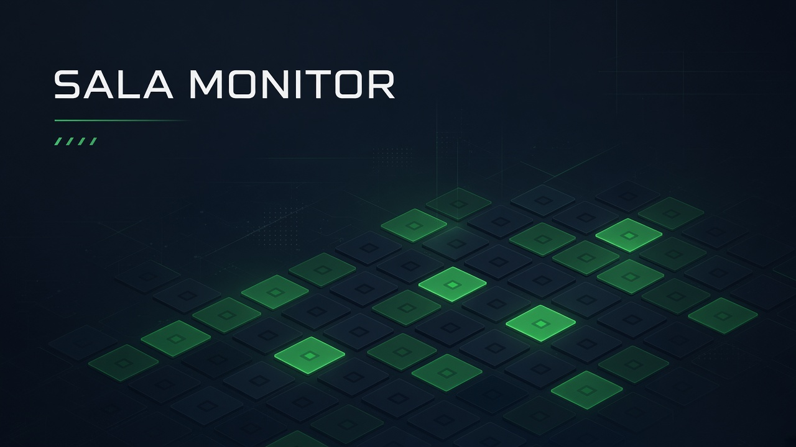
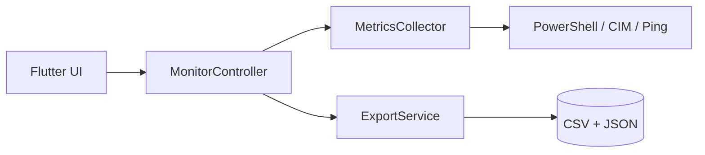

<p align="center">
  
</p>

<h1 align="center">Sala Monitor</h1>

<p align="center">
  <strong>Painel desktop para laboratório de informática</strong><br/>
  Veja quem está online, a saúde da rede e o estado das estações — em um clique.
</p>

<p align="center">
  
  
  
  
</p>

---

## Por que existe

Em um lab cheio, perguntar “qual PC caiu?” custa tempo.  
O **Sala Monitor** transforma a sala em um **quadro vivo**: ping nas máquinas que você cadastrou, métricas da estação local e exportação limpa para CSV/JSON.

Sem varredura caótica da rede. Sem vínculo institucional no código. Só o essencial para quem cuida do laboratório.

---

## O que ele faz

| Capacidade | Detalhe |
|------------|---------|
| **Quadro da sala** | Lista/grid das estações cadastradas — online/offline em destaque |
| **Ping inteligente** | Latência (ms) e perda (%) só nos IPs da sala |
| **Saúde local** | CPU, RAM, disco, uptime, adaptador, IP/MAC via WMI/CIM |
| **Salas nomeadas** | Ex.: `Sala 01` — troque a lista e o contexto muda |
| **Exportação** | `metricas_*.csv`, `hosts_rede.csv`, `ultimo_snapshot.json` |
| **UI escura** | Material 3, foco em TV / mesa do técnico |

```text
  [Configurar IPs] → [Iniciar] → [Quadro ao vivo] → [CSV/JSON opcional]
```

---

## Tour rápido

1. Abra o app → **Configurações**
2. Nome da sala + IPs (um por linha ou faixa `192.168.15.10-40`)
3. Intervalo sugerido: **30 s**
4. Volte e clique **Iniciar**
5. Use **Atualizar agora** quando quiser forçar uma coleta

Formatos de IP aceitos:

```text
10.0.0.10
10.0.0.20-40
10.0.0.50-10.0.0.60
# comentários com # são ignorados
```

---

## Arquitetura (resumo)



Detalhes em [`docs/ARCHITECTURE.md`](docs/ARCHITECTURE.md).

---

## Rodar / buildar

**Desenvolvimento**

```bat
flutter pub get
flutter run -d windows
```

**Release**

```bat
flutter build windows --release
```

O executável fica em:

```text
build\windows\x64\runner\Release\sala_monitor.exe
```

> Copie a pasta `Release` **inteira** (`.exe` + `data` + DLLs). Só o `.exe` sozinho não sobe.

---

## Onde grava

| Destino | Quando |
|---------|--------|
| `C:\SalaMonitor\dados` | pasta recomendada (se configurada / padrão do app) |
| Pasta customizada | campo “Pasta de exportação” nas Configurações |

Arquivos típicos: histórico local, inventário da sala, snapshot JSON.

---

## Stack

- **Flutter** desktop (Windows) · Material 3
- **PowerShell** embutido na coleta (`Test-Connection`, `Get-CimInstance`)
- **fl_chart** para histórico de perda/latência
- Persistência leve de preferências locais

---

## Portfólio / privacidade

Este repositório é **solo** e **neutro**:

- sem logos de instituições  
- sem e-mails pessoais  
- IPs de exemplo sempre privados/fictícios  

Projeto de demonstração técnica e uso educacional.

---

## Licença

[MIT](LICENSE) © 2026 [EduardoNathan1402](https://github.com/EduardoNathan1402)
